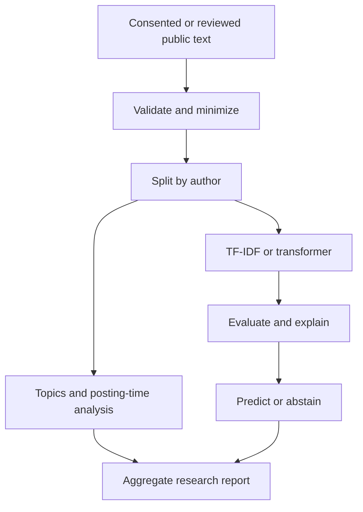

# Social Human Activity Recognition

A Python research framework for classifying **activities expressed in social text**,
exploring corpus topics and posting-time patterns, and explaining predictions.
It supports eligible posts, comments and profile text with auditable provenance.

**Research status:** functional source code and a synthetic teaching fixture.
No real social-media benchmark, validated psychological instrument, or pretrained
activity checkpoint is claimed.

## From text to a reviewable result

For example, "I am cooking vegetable soup" can receive a food label, confidence and
signed word contributions. This means the text describes food preparation; it does
not establish what a person actually did.



## Quick start

Python 3.10+; run commands from the repository root.

```bash
python -m pip install -e ".[dev]"
socialhar demo --output outputs/demo
socialhar predict --model outputs/demo/baseline.joblib --text "I am cooking soup"
python -m pytest -q
python scripts/check_notebooks.py
```

For your own eligible dataset:
```bash
socialhar train --data path/to/reviewed.csv --output outputs/study --seed 42 --threshold 0.5
```

The CSV must follow the [data contract](data/README.md). The validator requires a
documented eligibility marker; researchers remain responsible for the underlying
reuse review. Default execution downloads no models or platform data.

## Implemented capabilities

| Component | Implementation |
|---|---|
| Data quality | Strict schema, provenance markers, timezone checks, duplicate-ID rejection |
| Minimization | Contact-pattern redaction, keyed pseudonym helper, text deduplication |
| Activity models | TF-IDF + logistic regression; optional supervised DistilBERT |
| Evaluation | Author-disjoint splits, per-class metrics, log loss, confusion matrix |
| Uncertainty | Subject-cluster bootstrap, reliability bins, confidence-based abstention |
| Topic discovery | Training-only TF-IDF + nonnegative matrix factorization |
| Temporal analysis | Posting-hour aggregates with minimum subject counts |
| Explanations | Exact signed linear feature contributions and logit reconstruction |
| Psychology tools | VADER textual sentiment, Cohen kappa, Pingouin Welch comparison |
| Reproducibility | Seeds, dataset hash, package versions, CLI reports and CI |

Labels: **work, study, exercise, food, leisure, social, other**. This is a single-label
implementation; ambiguous, hypothetical and mixed activity descriptions need careful
annotation and challenge testing.

## Optional transformer experiment

```bash
python -m pip install -e ".[transformers]"
```

See [notebook 05](notebooks/05_transformers.ipynb). Set
SOCIALHAR_RUN_TRANSFORMER=1 to enable its training cell. It downloads DistilBERT and
trains a new task head, using separate validation authors. The outer test set stays
untouched. No transformer training results are bundled.

## Psychology-informed analysis

```bash
python -m pip install -e ".[psychology]"
python -m nltk.downloader vader_lexicon
```

[Notebook 08](notebooks/08_psychology.ipynb) demonstrates agreement, optional VADER,
and independent-subject statistical comparison. Sentiment describes language, not
mental health or personality. Physiological analysis is outside scope because inputs
are text, not physiological signals. See [interpretation limits](docs/psychology.md).

## Data and notebooks

The project supplies [490 fictional records](data/synthetic/activities.csv) across
70 fictional authors, with a [datasheet](data/datasheet.md). Templates overlap across
authors, making this a smoke-test fixture rather than a benchmark. High synthetic
scores would not demonstrate real-world generalization.

[Ten notebooks](notebooks/README.md) cover data audit, privacy, splitting, baseline,
transformers, topics, temporal patterns, psychology, explanations and uncertainty.
Their default cells are offline. Heavy optional experiments are explicit opt-ins.
Notebook files contain no fabricated execution outputs.

## Outputs

The CLI writes:
- metrics.json: per-class results, bootstrap interval, reliability and coverage
- manifest.json: dataset hash, seed, package versions and split sizes
- predictions.csv: record IDs, labels and confidence without raw text or subject IDs
- topics.json, aggregate_activity.csv and explanation.json
- baseline.joblib: a locally trained model; load only trusted artifacts

Outputs stay in ignored local directories. A fitted vectorizer retains vocabulary,
so a model trained on real text also needs controlled storage.

## Research design and limits

Author separation reduces repeated-author leakage; it does not remove paraphrase,
template or platform leakage. The default threshold is fixed rather than validated.
Real studies need separate validation data, representative eligible samples,
independent annotation, domain-shift testing and an analysis plan.
Posting time does not establish activity time. Confidence is not proof of correctness.
Regex redaction and small-cell suppression do not guarantee anonymity.

Read the [evaluation plan](docs/evaluation.md), [annotation guide](docs/annotation.md),
[model card](models/README.md), [privacy guidance](privacy/README.md) and
[research protocol](research/README.md). No diagnosis, personality scoring, identity
linking or covert tracking is supported.

## Repository guide

```text
src/socialhar/    Data, models, evaluation, explanations and CLI
data/            Synthetic fixture and datasheet
notebooks/       Ten research walkthroughs
docs/            Architecture, annotation, evaluation and references
research/        Study protocol and open experiments
privacy/         Data handling and reporting limits
models/          Model card
tests/           Behavioral and end-to-end checks
scripts/         Fixture regeneration and notebook checks
reports/         Reporting conventions
examples/        Runnable commands
```

## Verification and contribution

GitHub Actions installs the package and runs core tests, the demo and all default
notebook cells on Python 3.10–3.12. Optional transformer and psychology extras need
separate checks. Check the workflow status before relying on any result.
See [CONTRIBUTING.md](CONTRIBUTING.md) and [primary references](docs/references.md).

MIT license. Project-authored synthetic data uses the same license.
