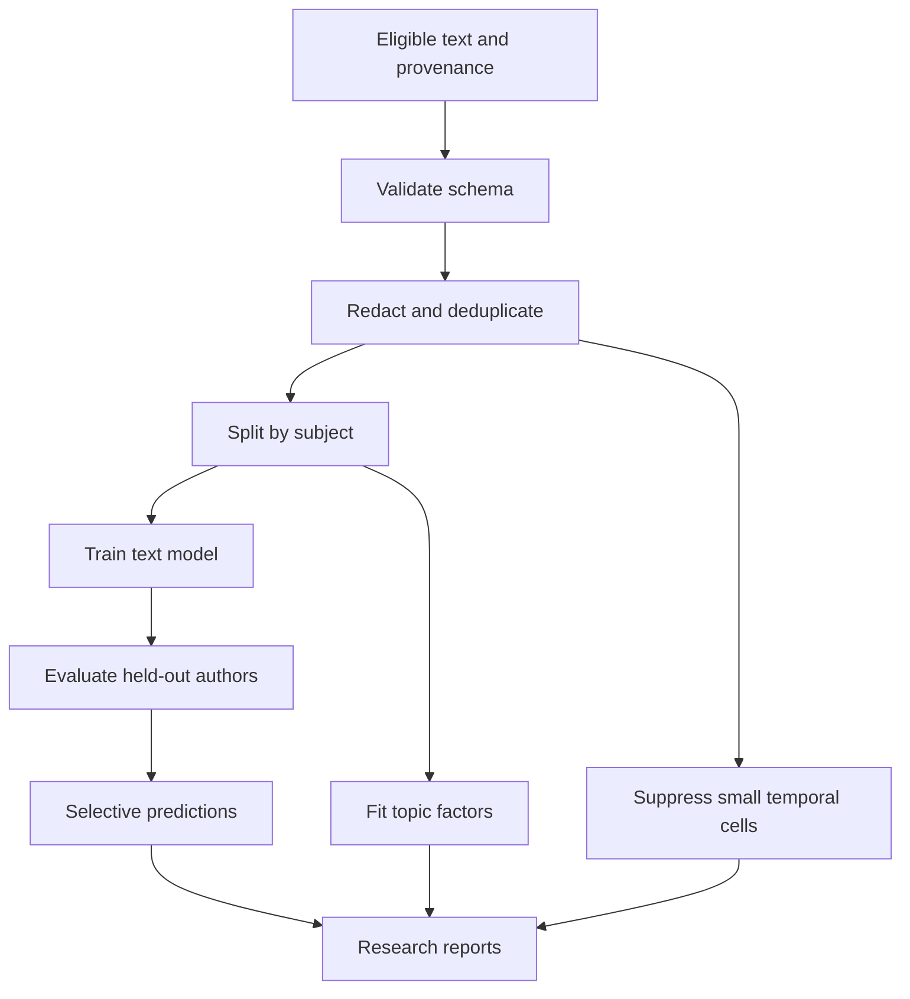

# Architecture and contracts

schema.validate fails closed on missing fields and unreviewed permission markers.
privacy.prepare performs regex minimization and exact-text deduplication.
split.grouped_split keeps subjects apart. It cannot eliminate paraphrase or
template overlap; real corpora require near-duplicate and cross-platform audits.
models.baseline fits vectorization exclusively within the training pipeline.
transformer.train_transformer consumes separate train/validation groups and saves
a local checkpoint. cli.run trains the baseline and exports reproducibility metadata.

No scrapers, account enrichment, identity linking or tracking services are provided.
Record-level predictions identify expressions in text. Aggregate posting patterns
describe the corpus, not a subject's physical location or routine.
